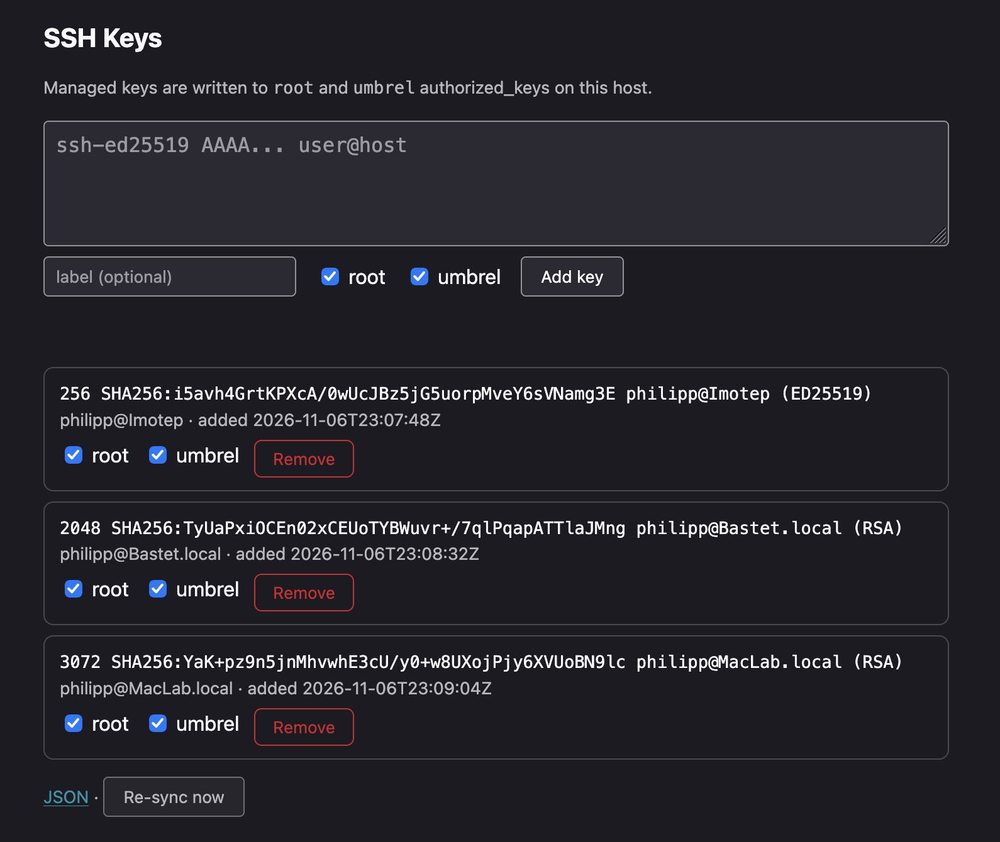

# umbrel-ssh

Manage SSH access on Umbrel: add and remove public SSH keys for the `root`
and `umbrel` users through a web UI. The app keeps a collection of trusted
keys, renders them into both users' `authorized_keys` files and re-syncs
them on every boot of the container.

## Features

- **Web UI** — list, add and remove public keys, mark them as trusted
- **Key collection** — single source of truth stored as JSON in the app's
  data directory (survives app updates)
- **Two targets** — writes `authorized_keys` for `root` and for `umbrel`
  (selectable per key or for all keys)
- **Boot sync** — on container start, `authorized_keys` files are rebuilt
  from the collection, so host-side edits or OS updates can't lock you out
- **Safety** — a key that is managed by the app can never be lost: it lives
  in the collection, not only in `authorized_keys`

## How it works

```
keys.json (collection)  ──sync on boot / on change──▶  /root/.ssh/authorized_keys
        ▲                                              /home/umbrel/.ssh/authorized_keys
        │
   Web UI (add/remove/toggle)
```

The container runs privileged and mounts the host's `/root` and `/home`
directories. The sync service (Python 3 stdlib only) validates every key
(`ssh-keygen -l -f`) before it is written, keeps file permissions strict
(`700` for `.ssh`, `600` for `authorized_keys`) and preserves the ownership
of the `umbrel` user (`uid 1000`).

## Development



```bash
docker build -t umbrel-ssh .
docker run --rm -d --name umbrel-ssh-test -p 16161:16161 umbrel-ssh
open http://localhost:16161
```

The service listens on port `16161` (configurable via `SSH_PORT`).

## Umbrel app store layout

The app follows the umbrel app conventions:

- `umbrel-app.yml` — app manifest (id, version, port 16161)
- `docker-compose.yml` — privileged container, mounts `/root` and `/home`
- `docker/` — service implementation (Python 3 stdlib)

## Security notes

- The web UI has **no authentication by default** — protect it via the
  Umbrel dashboard (iFrame access is only available to logged-in dashboard
  users) and do not expose the port outside the host.
- Everyone who can add a key through the UI gets root access to the VM.
  Treat the app itself as privileged infrastructure.
- Keys are validated for syntactic correctness only; they are not checked
  against a CA or an external trust store.
